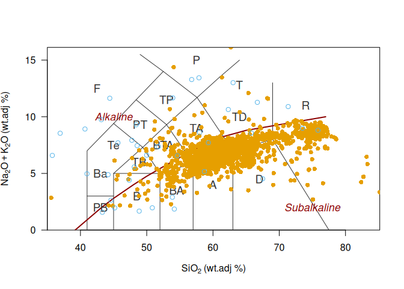

<!-- README.md is generated from README.Rmd. Please edit that file -->

# cipwnormR

<!-- badges: start -->

<!-- badges: end -->

# cipwnormR

CIPW norm in R

According to the IUGS (International Union of Geological Science),
Subcommission on the Systematics of Igneous Rocks, the primary
classification of igneous rocks must be based according to their modal
mineral composition, expressed in volume percent. Nevertheless, where
these data are not available or can not be determined owing to
fine-grained mineral assemblage, glassy content or changes in the
original mineralogy, then other criteria based on chemical bulk
composition may be used.

## Installation

You can install the development version of cipwnormR from
[GitHub](https://github.com/) with:

``` r
# install.packages("pak")
pak::pak("tobiste/cipwnormR")
```

## Load package

``` r
library(cipwnormR)
```

## CIPW norm for a geochemical dataset

The CIPW Norm is the most commonly used calculation algorithm to
estimate the standard mineral assemblages for igneous rocks , generated
over more than a hundred years ago and thereafter modified by some
authors to the passage of the years (e.g., Verma et al., 2002). It is
based upon assumptions about the order of mineral formation and known
phase relationships of rocks and minerals, using simplified mineral
formulas.

``` r
data(Andes)
Andes_cipw <- cipw(Andes)
head(Andes_cipw[, c('Magma', 'Rock.TAS', 'Fe.ratio', 'Q', 'Ab', 'An')])
#>                  Magma              Rock.TAS Fe.ratio         Q       Ab
#> SAR-00-08 Intermediate        Trachyandesite      0.4  5.545960 43.69922
#> SAR-00-07 Intermediate Trachyte/Trachydacite      0.5 12.087007 40.54248
#> SAR-00-13 Intermediate        Trachyandesite      0.4  7.544568 42.81869
#> SAR-00-06 Hypersilicic Trachyte/Trachydacite      0.5 21.660115 35.72615
#> SAR-00-10 Hypersilicic              Rhyolite      0.5 23.410638 38.45344
#> SAR-00-03 Hypersilicic Trachyte/Trachydacite      0.5 16.456237 41.81666
#>                 An
#> SAR-00-08 14.05683
#> SAR-00-07 14.92151
#> SAR-00-13 13.60649
#> SAR-00-06 12.61243
#> SAR-00-10 10.64923
#> SAR-00-03 12.01446
```

In the option , the trace elements that can be used are Ba, Cl, Co, Cr
Cs, F, Li, Ni, Rb, S, Sr, V and Zr. Additionally, the oxides
concentrations of Cr2O3, NiO and SO3 (expressed as wt. percent) are
handled like trace elements as well. However Cr2O3 are preferable to Cr
and NiO to Ni. Sulfur concentration when available is reported as either
SO3 or S, in which case their separate identity should be maintained.

``` r
Andes_cipw_trace <- cipw_trace(Andes)
head(Andes_cipw_trace[, c('Magma', 'Rock.TAS', 'Fe.ratio', 'Q', 'Ab', 'An')])
#>                  Magma              Rock.TAS Fe.ratio         Q       Ab
#> SAR-00-08 Intermediate        Trachyandesite      0.4  5.318246 43.57282
#> SAR-00-07 Intermediate Trachyte/Trachydacite      0.5 11.887466 40.48754
#> SAR-00-13 Intermediate        Trachyandesite      0.4  7.362592 42.80517
#> SAR-00-06 Hypersilicic Trachyte/Trachydacite      0.5 21.357032 35.70360
#> SAR-00-10 Hypersilicic              Rhyolite      0.5 23.153854 38.47677
#> SAR-00-03 Hypersilicic Trachyte/Trachydacite      0.5 16.234649 41.78423
#>                 An
#> SAR-00-08 14.05797
#> SAR-00-07 14.91704
#> SAR-00-13 13.56612
#> SAR-00-06 13.09186
#> SAR-00-10 10.88867
#> SAR-00-03 12.00759
```

## TAS plot

Computed from the chemical composition, the normative mineralogy is an
alternative approach for mineralogical classification and useful for set
up the naming of igneous rocks (as parts of the TAS classification, ).

``` r
data(TestTAS)

TASplot(Andes, col = "#E69F00", pch = 16)
TASplot(TestTAS, col = "#56B4E9", add = TRUE)
```


